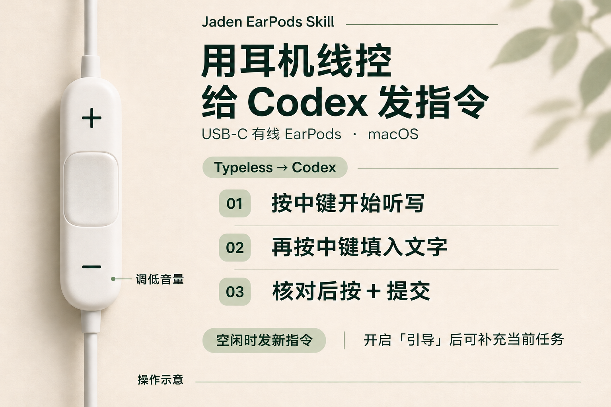

# Jaden EarPods Skill

用 Mac 上的 **Apple USB-C 有线 EarPods** 给 Codex 发语音指令。按中键开始说，再按一次，Typeless 就把文字填进 Codex 输入框。看完按「＋」提交，手可以留在耳机线控上。



## 「＋」按下去会怎样

把光标留在 Codex 输入框，等转写完成再按「＋」。它会执行 Codex 的 **Command＋回车** 提交动作。

| Codex 的状态 | 按「＋」之后 |
| --- | --- |
| 空闲 | 发送输入框里的文字，开始处理新指令 |
| 正在执行，后续消息设为「引导」 | 把补充发给当前任务，例如让它缩小范围或修正方向 |
| 正在执行，后续消息设为「排队」 | 把这条消息排到当前任务之后 |

「＋」在 Codex 桌面应用位于前台且助手获得辅助功能授权时用来提交。在其他应用里仍可调高音量。「－」调低音量。

## 从 Codex 安装

准备好 Mac、Apple USB-C 有线 EarPods、Typeless、Codex 桌面应用和 Xcode 命令行工具。

1. 在 Codex 发送下面这句，把 Skill 安装到 Codex。

   ```text
   用 $skill-installer 从 https://github.com/riiiku/jaden-earpods-skill 安装 jaden-earpods-skill 目录。
   ```

2. 安装完成后，在下一条消息发送 `用 $jaden-earpods-skill 帮我配置 USB-C EarPods`。Skill 会检查设备和映射冲突，按步骤安装本机助手。
3. 按 Skill 指引设置 Typeless 的**右 Shift** 听写快捷键和 Codex 的 **Command＋回车** 发送快捷键。要在执行中用「＋」引导，就把 Codex 的「后续消息处理方式」设为「引导」。
4. 在 macOS「系统设置 → 隐私与安全性 → 辅助功能」为 **Jaden EarPods Remote** 开启权限。回到 Codex 输入框，先说一句短测试，检查文字后再按「＋」。

手动安装、冲突检查和卸载命令见[完整设置说明](jaden-earpods-skill/references/setup.md#中文设置步骤)。

## 适用范围

此版本匹配 USB 标识为 `0x05AC:0x110B` 的 Apple USB-C 有线 EarPods。个人原型在 Apple silicon、macOS 26.6.2 上验证了听写、填入文字、重插后听写和向 Codex 提交。公开包通过了编译、签名和安装冲突检查，全新安装后的实体按键仍待复测。[验证记录](jaden-earpods-skill/references/setup.md#verification)

## English

Use the inline remote on Apple USB-C EarPods to dictate into Codex on a Mac. Tap the center button to start Typeless and tap again to insert the transcription. Read the text, then press **+** to submit it in the focused Codex composer.

When Codex is idle, **+** starts a new request. While it is working, **Steer** sends the follow-up to the active task and **Queue** holds it for the next turn. Volume down stays on **−**.

Ask Codex to install the `jaden-earpods-skill` folder from `riiiku/jaden-earpods-skill` with `$skill-installer`. Invoke `$jaden-earpods-skill` on your next turn. The Skill guides you through installing the local helper, setting the app shortcuts, and enabling macOS Accessibility for **Jaden EarPods Remote**. [Setup and recovery](jaden-earpods-skill/references/setup.md)

The build targets macOS 13 or later. The [verification notes](jaden-earpods-skill/references/setup.md#verification) describe the prototype and package checks.

## References

感谢 **Sergo Lebedovich**。开发时参考了他的 EarPods AI Keys，包括如何识别 USB-C EarPods、用 `hidutil` 对指定设备做按键映射，以及根据连接事件恢复映射。该项目的默认配置用于 macOS 原生听写、退格和回车。[EarPods AI Keys](https://github.com/metalebedenko/earpods-ai-keys)

本项目沿着这个思路另行实现了 **Typeless 听写和 Codex 提交**。中键触发 Typeless，「＋」在 Codex 前台提交核对过的文字，由 Codex 按「引导」或「排队」处理后续消息。仓库提供可安装的 Skill、按键冲突检查、状态检查和卸载。

Thanks to **Sergo Lebedovich**. The device-specific HID mapping and connection handling in EarPods AI Keys informed this project. Jaden EarPods Skill implements the Typeless and Codex workflow separately, with guided installation, conflict checks, and uninstall. [EarPods AI Keys](https://github.com/metalebedenko/earpods-ai-keys)

整理引用时也查到了这两个更早公开的同类项目：

- **AirPodKit**（wdwxw）提供通用的有线耳机按键映射，文档中有 Typeless 听写与提交示例。[AirPodKit](https://github.com/wdwxw/airpodKit)
- **Codepods**（loutlot）用有线 EarPods 控制 ChatGPT 桌面应用，支持用线控切换近期模型和启动或停止语音输入。[Codepods](https://github.com/loutlot/codepods)

macOS 按键映射、Typeless 和 Codex 设置的官方文档见[技术资料](jaden-earpods-skill/references/setup.md#technical-references)。

[MIT License](LICENSE)
